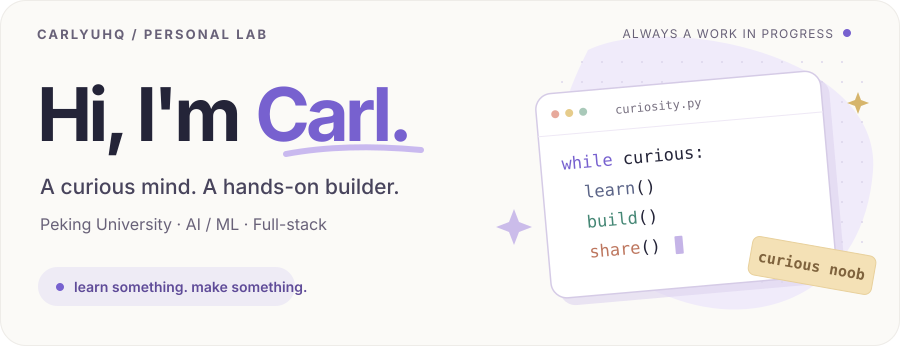
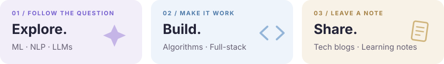
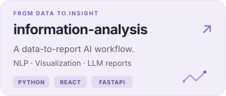
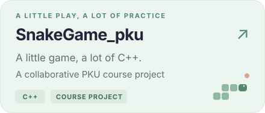
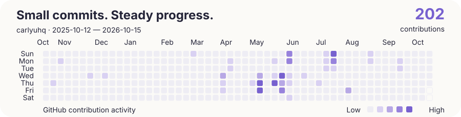

  

  <a href="https://carlyuhq.github.io/"><b>Website ↗</b></a>
  &nbsp;&nbsp; / &nbsp;&nbsp;
  <a href="https://carlyuhq.github.io//Blogs/"><b>Blogs ↗</b></a>
  &nbsp;&nbsp; / &nbsp;&nbsp;
  <a href="https://www.linkedin.com/in/carlyuhq/"><b>LinkedIn ↗</b></a>
  &nbsp;&nbsp; / &nbsp;&nbsp;
  <a href="mailto:2501211863@stu.pku.edu.cn"><b>Say hello ↗</b></a>

 

### A little about the person behind the commits

I'm **Hanqing Yu (Carl)**, a student at **Peking University**. I explore **machine learning, NLP, and LLMs** — and enjoy turning what I learn into working code.

Right now: going deeper into **algorithms**, tinkering with **AI**, and writing down the things I figure out. Always happy to exchange ideas, learn from others, and build something together.

  

### A few things I've been building

  
  

[More repositories ↗](https://github.com/CarlYuHQ?tab=repositories)

### My working toolkit

**Code** &nbsp; `Python` · `C++` · `C` · `JavaScript` · `Java`  
**Data** &nbsp; `MySQL` · `PostgreSQL` · `MongoDB` · `Redis`  
**Build** &nbsp; `Git` · `Linux` · `Node.js` · `Qt`

  
A few more tools I've worked with

   
  <code>Oracle</code> · <code>Hadoop</code>

### From my notebook

I like writing things down while they're still fresh — technical walkthroughs, experiments, and notes from learning in public.

- [**Tech blogs**](https://carlyuhq.github.io//Blogs/) — ideas, experiments, and things that finally clicked.
- [**Learning notes**](https://carlyuhq.github.io/Notes/) — a growing collection of what I'm studying.

### One commit at a time

Generated from GitHub's official contribution calendar. <a href="https://github.com/CarlYuHQ?tab=overview">Live activity ↗</a>

  

  <i>Still a noob. Just asking better questions.</i> 
  Learn something. Make something. Share something.

